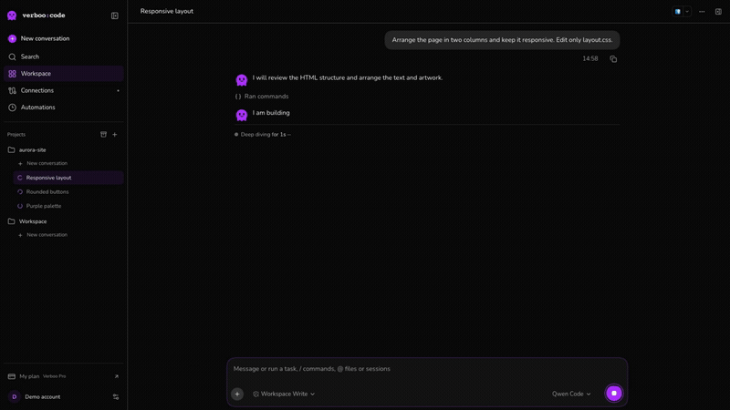

# Verboo Code

English | [中文](README.zh.md)

Verboo Code is a Tauri desktop coding app with Verboo login, account models, projects and connected tools. It uses the [DeepSeek Harness](https://github.com/deepseek-ai/deepseek-harness) engine and its Cordis plugin architecture.

[Get Verboo Code](https://verboo.ai/?utm_source=github&utm_medium=referral&utm_campaign=readme) · [Download for macOS, Windows or Linux](https://verboo.ai/download?utm_source=github&utm_medium=referral&utm_campaign=readme) · [Release notes](https://verboo.ai/updates)

[](https://discord.gg/e2tcxmDd7h)



## Models and benchmarks

| Model examples | Context window |
| --- | ---: |
| DeepSeek V4.1 Flash | 1,048,576 tokens |
| HY4 Flash | 1,048,576 tokens |
| Qwen 3.8 27b | 262,144 tokens |

Model access depends on your plan. See the [live model catalog](https://verboo.ai/en/api) and the repository's [long-session benchmark](benchmarks/long-session-browser/README.md) and [stream reconnection benchmark](benchmarks/active-stream-reconnect/README.md).

<a id="run"></a>

<a id="run-from-source"></a>

## Development

Install Node.js 24.9 or newer, pnpm, Rust and the [Tauri prerequisites](https://v2.tauri.app/start/prerequisites/), then run:

```sh
git clone https://github.com/verbeux-ai/verboo-code-v2.git
cd verboo-code-v2
pnpm install
pnpm run dev:desktop
```

Sign in with your Verboo account in the system browser. Model access and subscription state come from the Verboo API. Composio service credentials belong only to the central backend; the desktop never receives them.

For a browser preview after `pnpm run build:artifacts`, run:

```sh
pnpm dsh --profile verboo --no-open
```

The original upstream Web composition remains available as `pnpm dsh --profile web --no-open`. Profiles use separate composition files. See the [product bundle](packages/bundle/verboo-app/README.md) for upstream updates and the [desktop runtime](apps/desktop/tauri/README.md) for native builds.

## Product packages

- [Interface](packages/client/ui-verboo/README.md): onboarding, purple palette, project navigation, plans and connections.
- [Account](packages/credentials/verboo-account/README.md): OAuth PKCE, encrypted grants and account-authorized inference.
- [Product API](packages/api/verboo-product/README.md): display-safe account data and trusted browser handoffs.
- [Connections](packages/extensions/verboo-connections/README.md): user-owned external tools for Agents.

## Contributing

Read [AGENTS.md](AGENTS.md), the [architecture](docs/architecture.md), the [development guide](docs/development.md) and [safety notice](SAFETY.md). Internal `@deepseek-ai` package names identify upstream components and remain stable for updates and saved Sessions.

## License

[MIT](LICENSE). Upstream copyright notices remain intact. Font and icon licenses are recorded in [product asset licenses](packages/client/ui-verboo/LICENSES.md).
